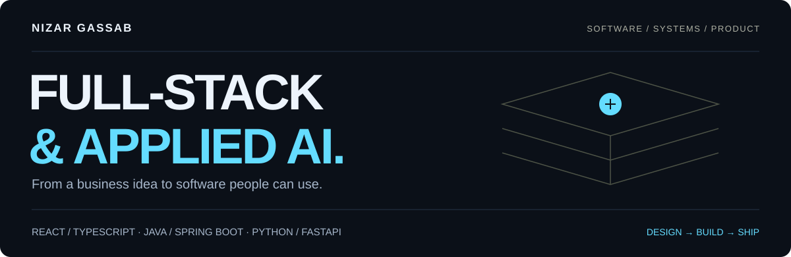
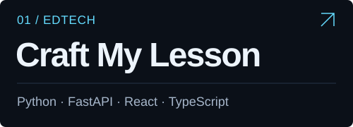
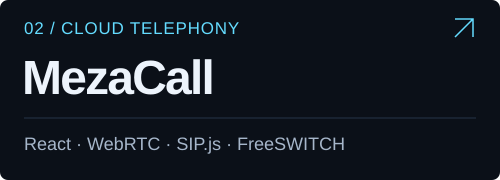
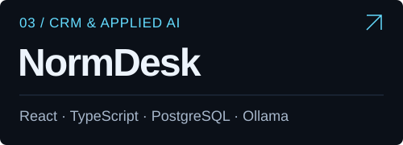
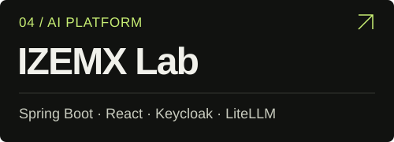
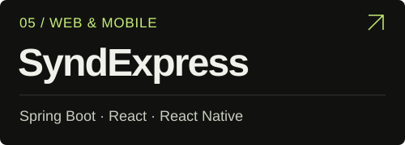
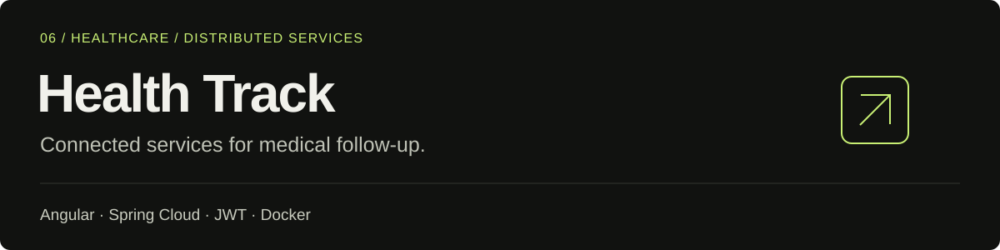

  <a href="https://nizar-gassab-portfolio.vercel.app/"><strong>Portfolio ↗</strong></a>&nbsp;&nbsp; / &nbsp;&nbsp;
  <a href="https://www.linkedin.com/in/nizar-gassab-b872b5244/">LinkedIn</a>&nbsp;&nbsp; / &nbsp;&nbsp;
  <a href="https://www.upwork.com/freelancers/~01e66249ec727ea66f">Upwork</a>&nbsp;&nbsp; / &nbsp;&nbsp;
  <a href="mailto:nizargassab36@gmail.com">Get in touch</a>

### I build the interface, the services, and the connections between them.

I'm **Nizar**, a full-stack developer based in Casablanca. I build web applications and SaaS products, working across **React/TypeScript, Java/Spring Boot and Python/FastAPI**. My projects connect product interfaces with secure APIs, payments, document generation, real-time communications and practical AI integrations.

I work from the business workflow through implementation and deployment, with attention to access control, reliable integrations and the details people interact with every day.

## Selected work

Freelance products and team contributions. Each project links to a public overview with my role, technical scope and stack.

<table>
<tr>
<td width="50%" valign="top">

Custom images into printable classroom activities. PDF generation, user accounts, credits and payment webhooks.

<a href="https://github.com/nizargassab/craft-my-lesson-showcase"><strong>Read the case study →</strong></a>

</td>
<td width="50%" valign="top">

Browser calling with WebRTC and FreeSWITCH. Agent workflows, live supervision and access by company and role.

<a href="https://github.com/nizargassab/mezacall-showcase"><strong>Read the case study →</strong></a>

</td>
</tr>
<tr>
<td width="50%" valign="top">

CRM and agent workflows with document-grounded AI and voice assistance in a multi-company workspace.

<a href="https://github.com/nizargassab/normdesk-showcase"><strong>Read the case study →</strong></a>

</td>
<td width="50%" valign="top">

Team contribution to an AI SaaS: secure microservices, a seven-module back office and usage tracking.

<a href="https://github.com/nizargassab/izemx-lab-showcase"><strong>Read the case study →</strong></a>

</td>
</tr>
<tr>
<td width="50%" valign="top">

Team contribution to a property-management SaaS with business microservices and web/mobile interfaces.

<a href="https://github.com/nizargassab/syndexpress-showcase"><strong>Read the case study →</strong></a>

</td>
<td width="50%" valign="top">

Team contribution to medical follow-up with an Angular dashboard, Spring Cloud services and JWT authentication.

<a href="https://github.com/nizargassab/health-track-showcase"><strong>Read the case study →</strong></a>

</td>
</tr>
</table>

**More projects:** [Interactive KPI dashboard](https://nizar-gassab-portfolio.vercel.app/projets/dashboard-kpi/) · [Responsible e-commerce](https://nizar-gassab-portfolio.vercel.app/projets/eco-commerce/) · [University chatbot](https://nizar-gassab-portfolio.vercel.app/projets/chatbot-universitaire/)

## My engineering stack

| Area | Tools I use | Applied to |
| :--- | :--- | :--- |
| **Frontend & mobile** | React, TypeScript, Angular, React Native, Tailwind CSS | Product interfaces, dashboards and web/mobile workflows |
| **Backend & APIs** | Java, Spring Boot, Spring Cloud, Python, FastAPI, Node.js | Business services, REST APIs, microservices and PDF generation |
| **Data & access** | PostgreSQL, MySQL, Keycloak, JWT, OTP | Company boundaries, identity and role-based access |
| **AI & automation** | Ollama, LiteLLM, Vosk, Dialogflow, n8n | Document-grounded assistants, voice workflows and usage tracking |
| **Real-time communications** | WebRTC, SIP.js, FreeSWITCH | Browser telephony and call supervision |
| **Delivery & operations** | Docker, Kubernetes, GitHub/GitLab CI, AWS S3, Grafana | Packaging, deployment, storage and monitoring |
| **Integrations & validation** | Paddle, Stripe, webhooks, JUnit, Postman | Payments, credit accounting and API validation |

## What I bring to a project

- **Product thinking:** turn a business workflow into a clear interface and a practical service design.
- **End-to-end implementation:** connect frontend, backend, data and deployment instead of treating each layer in isolation.
- **Careful integration:** account for permissions, tenant boundaries and duplicate webhook events.
- **Team delivery:** contribute through readable code, tests, reviews and continuous integration.

<strong>Experience & background</strong>

 

| Context | Contribution |
| :--- | :--- |
| **Freelance product work** | Craft My Lesson, MezaCall and NormDesk |
| **IZEMX Lab · final-year internship · 2026** | Secure microservices, React back office and AI usage tracking |
| **Lumia Tech · internship · 2025–2026** | SyndExpress business services and React/React Native interfaces |
| **E-AMBITION · engineering internship · 2025** | Health Track services, authentication and Angular UI |
| **UCD Laboratory · internship · 2023** | Student-support chatbot with Dialogflow, Node.js and MySQL |

**Education:** Computer Engineering, EMSI Casablanca (2024–2026) · Mathematics & Computer Science, UCD (2019–2023).  
**Languages:** French, English and Arabic.

---

### Have a product to build or an integration to get right?

[Explore my portfolio](https://nizar-gassab-portfolio.vercel.app/) · [Tell me about your project](mailto:nizargassab36@gmail.com)
