<!-- Adapted from walidbosso/walidbosso; personalized layout and data. See NOTICE.md. -->

<a href="https://nizar-gassab-portfolio.vercel.app/">
  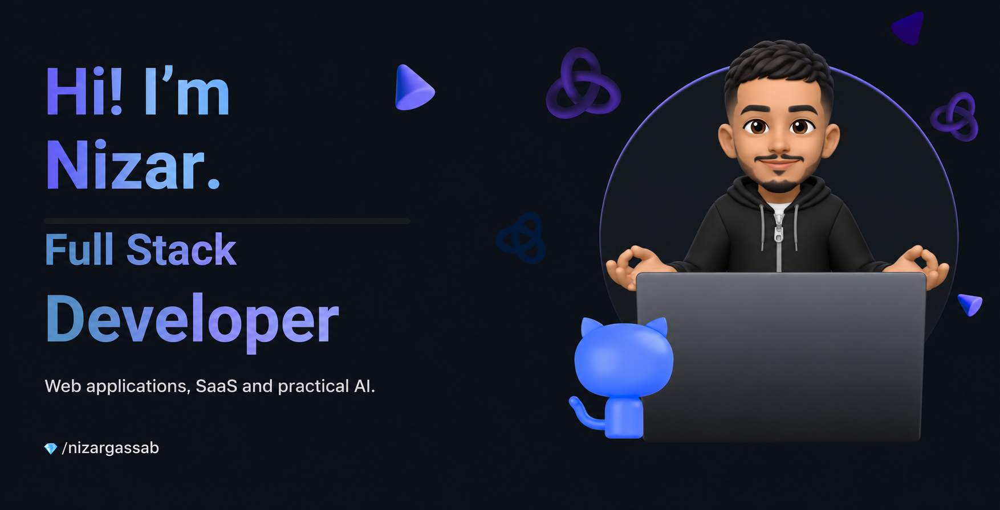
</a>

 

  
  
  

## Hello there, fellow &lt;coder /&gt;! 

> [!CAUTION]
> 🔖 You've found Nizar Gassab — a Full-Stack Developer based in Casablanca, Morocco.

> [!NOTE]
> 💻 I work with `React`, `TypeScript`, `Spring Boot` and `Python / FastAPI` to build web applications and SaaS products.

> [!IMPORTANT]
> 📚 My product work includes **Craft My Lesson**, **MezaCall** and **NormDesk** — classroom resources, browser telephony and CRM workflows.

> [!WARNING]
> 🛠️ I also contributed to **IZEMX Lab**, **SyndExpress** and **Health Track** as part of engineering teams.

> [!TIP]
> 📗 Explore the project demos or get in touch to talk about your application.

 

  
  
  

<a href="https://nizar-gassab-portfolio.vercel.app/"><strong>nizar-gassab-portfolio.vercel.app</strong></a>

<h3 align="center">【 Ｓｋｉｌｌｓ 】</h3>

| **Languages** | **Frontend** | **Backend** | **Data & AI** | **Tools** | **DevOps** |
| :---: | :---: | :---: | :---: | :---: | :---: |
|  | 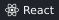 |  |  |  |  |
|  |  |  |  | 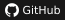 |  |
| 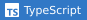 | 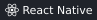 |  | 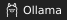 |  |  |
|  |  |  |  |  |  |
|  | 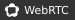 |  |  |  |  |
|  |  |  |  |  |  |

<strong>Computer Engineering — EMSI Casablanca</strong> French · English · Arabic

<h3 align="center">【 Ｓｔａｔｓ 】</h3>

  <a href="https://github.com/nizargassab">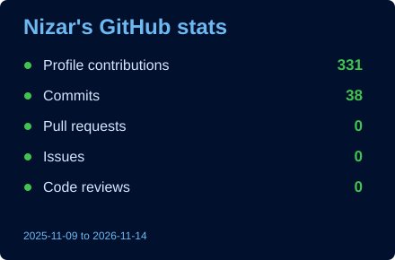</a>
  <a href="https://github.com/nizargassab?tab=repositories">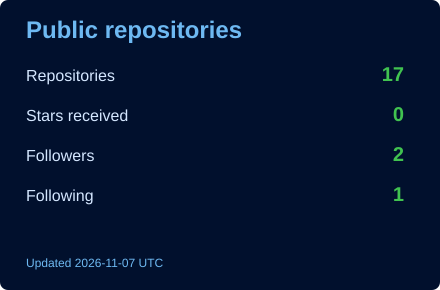</a>

📈 More Stats

 

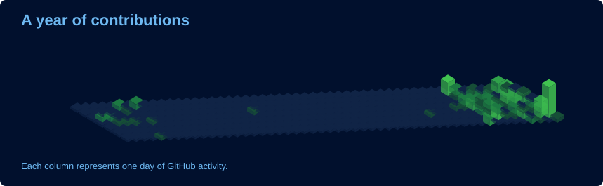

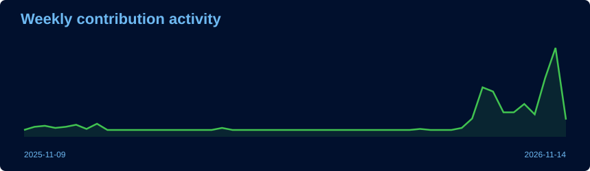

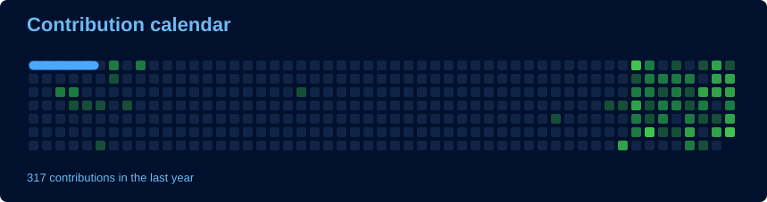

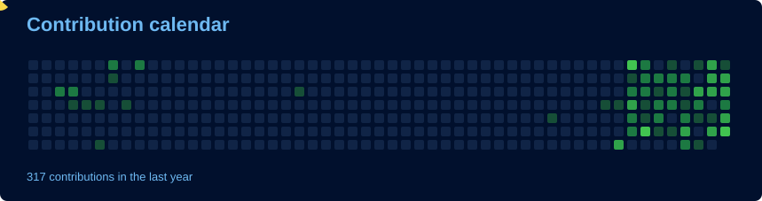

<h3 align="center">【 Ｐｒｏｊｅｃｔｓ 】</h3>

📁 Project repositories

 

  <a href="https://github.com/nizargassab/craft-my-lesson-showcase">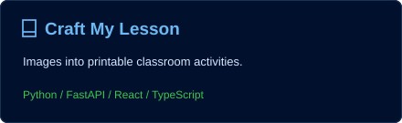</a>
  <a href="https://github.com/nizargassab/mezacall-showcase">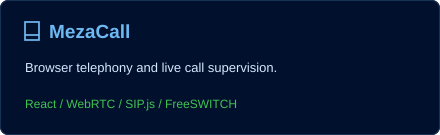</a>
  <a href="https://github.com/nizargassab/normdesk-showcase">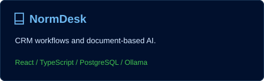</a>
  <a href="https://github.com/nizargassab/izemx-lab-showcase">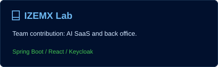</a>
  <a href="https://github.com/nizargassab/syndexpress-showcase">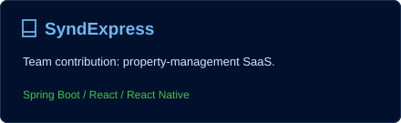</a>
  <a href="https://github.com/nizargassab/health-track-showcase">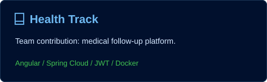</a>

<a href="https://nizar-gassab-portfolio.vercel.app/#projets"><strong>Explore all nine projects in my portfolio</strong></a>

<h3 align="center">【 Ｂａｃｋｇｒｏｕｎｄ 】</h3>

🎓 Experience & education

| Context | My contribution |
| :--- | :--- |
| Freelance products | Craft My Lesson, MezaCall and NormDesk |
| IZEMX Lab · final-year internship · 2026 | Secure microservices, React back office and AI usage tracking |
| Lumia Tech · internship · 2025–2026 | SyndExpress services and React / React Native interfaces |
| E-AMBITION · engineering internship · 2025 | Health Track services, authentication and Angular UI |
| UCD Laboratory · internship · 2023 | Student-support chatbot with Dialogflow, Node.js and MySQL |

**Education:** Computer Engineering, EMSI Casablanca (2024–2026) · Mathematics & Computer Science, UCD (2019–2023).

<h3 align="center">Thanks for stopping by! 💙</h3>

Take a look at the projects, explore the demos, or send me a message.

<a href="https://nizar-gassab-portfolio.vercel.app/">Portfolio</a> · <a href="mailto:nizargassab36@gmail.com">Email</a> · <a href="#top">Back to top ↑</a>

